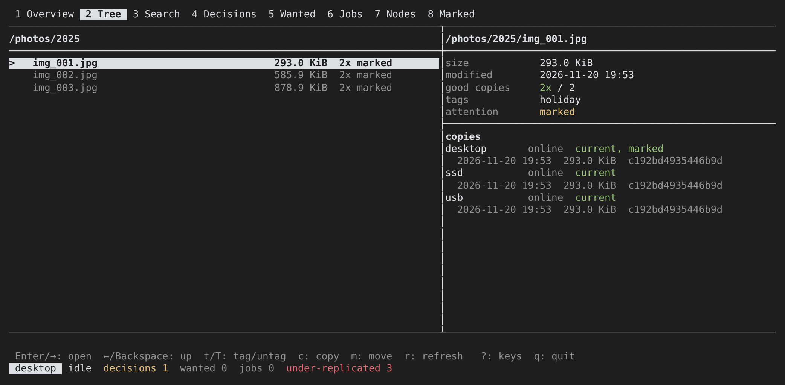

# rei-fs client

Terminal client for rei-fs, built with [FTXUI](https://github.com/ArthurSonzogni/FTXUI)
and meson/ninja. It connects to one rei-fs server at a time over HTTPS and
logs in with the server's admin password.



## Building

You need a C++20 compiler, meson ≥ 1.1, ninja and OpenSSL ≥ 3.0 (with
headers). FTXUI, cpp-httplib and nlohmann_json come from the system if
available, otherwise meson downloads them (see `subprojects/*.wrap`).

### Linux

```bash
sudo apt install build-essential meson ninja-build libssl-dev pkg-config   # Debian/Ubuntu
meson setup build
ninja -C build
./build/rei-fs
```

### Windows (MSYS2, UCRT64 shell)

```bash
pacman -S --needed mingw-w64-ucrt-x86_64-{gcc,meson,ninja,openssl,pkgconf}
meson setup build
ninja -C build
./build/rei-fs.exe
```

Use Windows Terminal for proper colours and Unicode.

Run the tests with `meson test -C build`. `tests/tui_smoke.sh BINARY PORT
PASSWORD` drives the real UI in tmux against a running server (CI runs it with
an AddressSanitizer build). To also test against a live
server, set `REIFS_TEST_PORT` and `REIFS_TEST_PASSWORD` (server on
127.0.0.1).

## Usage

```bash
rei-fs [HOST[:PORT]]                  # default port 7420
rei-fs --fingerprint HOST[:PORT]      # print the server's certificate fingerprint
```

The first time you connect to a server, the client shows the server's
certificate fingerprint. Compare it with `reifs fingerprint` on the server,
then trust it. It is remembered (like SSH known hosts). If it ever changes,
the client warns you and refuses to continue unless you explicitly trust the
new one. Settings live in `~/.config/rei-fs-client/client.json`
(`%APPDATA%\rei-fs-client` on Windows, or `$REIFS_CLIENT_HOME`).

### Tabs and keys

`1`-`9` or `F1`-`F9` switch tabs, `?` shows help, `q` quits. In the Search
tab, press `/` to type a search (`Esc` leaves the fields).

| Tab | What it shows | Keys |
|---|---|---|
| Overview | Copies, what the server is busy with (and for how long), database lock, the backup plan | `s` scan all, `j` run jobs, `p` plan backups, `g` copy goal, `a` automatic approval on/off, `x` stop |
| Tree | The virtual tree, where each file lives | `Enter`/`→` open, `←` up, `t`/`T` tag/untag, `c` copy, `m` move to a node, `x` pick up, `p` put here, `v` move to a typed directory, `n` rename, `d` new directory, `D` remove an empty one, `u` update priority |
| Search | Find files and folders by part of a name (or a glob like `*.jpg`), tag, problems | `/` type a search, `Enter` on a result show it in the Tree, `C`/`M` copy/move all results |
| Decisions | The decision stack | `Enter` decide, `a` apply to all of a kind |
| Wanted | Proposed jobs | `Space` select, `a`/`x` approve/reject, `A`/`X` all |
| Jobs | Job progress and failures | `j` run, `c` cancel, `y` retry, `h` history |
| Nodes | Nodes of all servers, foreign drives | `n` add a drive, `R` rename, `Space` choose nodes, `s` scan the chosen (or the selected) node, `S` scan all, `w` discover new files only, `c` check that the index accounts for everything on the disk, `m` move the node's root folder, `v` verify the same, `p` priority, `t` backup target, `o` adopt |
| Marked | Copies waiting for you to delete them | `u`/`U` keep (unmark) |
| Servers | This server's fingerprint, paired servers, pairing requests | `p` pair, `a`/`x` accept/reject, `d` unpair, `t` transport (daemon/SSH), `k` SSH key and authorize peers, `s` sync now |

`n` registers a drive: type the path of its folder *on the server's machine*
(for example `/media/me/SSD`, so it must be mounted there), then its name
(the folder's name by default). The server writes the drive's ID file, scans it,
and finds it again wherever it is mounted later.

**The interface never waits for the server.** Every request runs in the
background: a slow or busy server shows up as `waiting for the server (N, S s)`
in the status bar while the rest of the interface stays usable, and results
appear when they arrive. The Overview's *Activity and database* panel shows
what the server is doing (for example `scanning for 3 min 12 s` and the file it
is reading), whether the database's write lock is free, in use (and by what)
or held by another program, and how many writers wait for it.

Decisions, Wanted and Jobs show the items of every paired server (marked
`@server`); actions on them are sent to that server. Copying to another
server's node creates the job on that server, which pulls the files.
